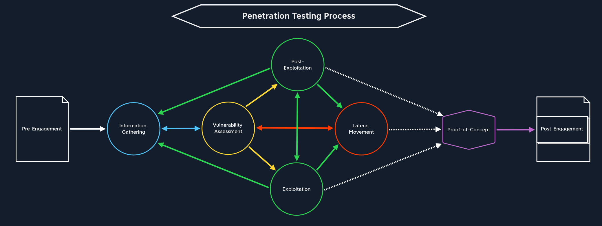

Web Reconnaissance is a critical phase of the information gathering phase of a penetration test

goals of web reconnaissance include 
- Identifying assets: Uncovering all publicly accessible components of the target, such as web pages, subdomains, IP addresses, and technologies used. This step provides a comprehensive overview of the target's online presence.
- Discovering Hidden Information: Locating sensitive information that might be inadvertently exposed, including backup files, configuration files or internal documentation. These findings can reveal valuable insights and potential entry points for attacks
- Analyzing the Attack Surface: Examining the target's attack surface to identify potential vulnerabilities and weaknesses. This involves assessing the technologies used, configurations, and possible entry points for exploitation
- Gathering Intelligence: Collecting information that can be leveraged for further exploitation or social engineering attacks. This includes identifying key personnel, email addresses, or patterns of behavior that could be exploited.
### Types of Reconnaissance
there is both active and passive reconnaissance, both play a role and have distinct advantages and disadvantages
##### Active Reconnaissance

Active reconnaissance is reconnaissance where the attacker directly interacts with the target system to gather information this includes 

| Technique                | Description                                                                                | Example                                                                                                                              | Tools                                                      | Risk of Detection                                                                                                  |
| ------------------------ | ------------------------------------------------------------------------------------------ | ------------------------------------------------------------------------------------------------------------------------------------ | ---------------------------------------------------------- | ------------------------------------------------------------------------------------------------------------------ |
| `Port Scanning`          | Identifying open ports and services running on the target                                  | Using Nmap to scan a web server for open ports                                                                                       | Nmap, Masscan, Unicornscan                                 | High: Direct interaction with the target can trigger IDS and firewalls                                             |
| `Vulnerability Scanning` | Probing the target for known vulnerabilities such as outdated software or miscofigurations | Running Nessus against a web application to check for SQL injection flaws or XSS                                                     | Nessus, OpenVAS, Nikto                                     | High: Vulnerability scanners send exploit payloads that security solutions can detect                              |
| `Network Mapping`        | Mapping the target's network topology, including connected devices and their relationships | Using traceroute to determine the path packets take to reach the target server, revealing potential network hops and infrastructure  | Traceroute, Nmap                                           | Medium to High: Excessive or unusual network traffic can raise suspicion                                           |
| `Banner Grabbing`        | Retrieving information from banners displayed by services running on the target            | Connecting to a web server on port 80 and examining the HTTP banner to identify the web server software and version                  | netcat, curl                                               | Low: Banner grabbing typically involves minimal interaction, but can still be logged                               |
| `OS Fingerprinting`      | Identifying the operating system running on the target                                     | Using Nmap's OS detection capabilities (-O) to determine if the target is running windows, linux, or another OS                      | nmap, xprobe2                                              | Low: OS fingerprinting is usually passive, but some advanced techniques can be detected                            |
| `Service Enumeration`    | Detecting the specific versions of services running on open ports                          | Using Nmap's service version detection (`-sV`) to determine if a web server is running Apache 2.4.50 or Nginx 1.18.0                 | Nmap                                                       | Low: Similar to banner grabbing, service enumeration can be logged but is less likely to trigger alerts            |
| `Web Spidering`          | Crawling the target website to identify web pages, directories, and files                  | Running a web crawler like Burp Suite Spider or OWASP ZAP Spider to map out the structure of a website and discover hidden resources | Burp Suite Spider, OWASP ZAP Spider, Scrapy (customizable) | Low to Medium: Can be detected if the crawler's behavior is not carefully configured to mimic legitimate traffice. |
while you can usually learn more via active reconnaissance, you also are more likely to get caught or raise suspicions

##### Passive Reconnaissance

Passive reconnaissance is gathering information about the target without directly interacting with the target. 

| Technique               | Description                                                                                                                    | Example                                                                                                                                          | Tools                                                                       | Risk of Detection                                                                                     |
| ----------------------- | ------------------------------------------------------------------------------------------------------------------------------ | ------------------------------------------------------------------------------------------------------------------------------------------------ | --------------------------------------------------------------------------- | ----------------------------------------------------------------------------------------------------- |
| `Search Engine Queries` | Utilizing search engines to uncover information about the target, including websites, social media profiles, and news articles | google dorking                                                                                                                                   | google, duckduckgo, Bing, Brave, and specialized search engines (ie shodan) | Very low: Search engine queries are normal internet activity and unlikely to trigger alerts           |
| `WHOIS lookups`         | Querying WHOIS databases to retrieve domain registration details                                                               | Performing a WHOIS lookup on a target domain to find the registrant's name, contact information, and name servers.                               | whois command-line tool, online whois lookup services                       | Very Low: WHOIS queries are legitimate and do not raise suspicion                                     |
| `DNS`                   | Analyzing DNS records to identify subdomains, mail servers, and other infrastructure                                           | using dig to enumerate subdomains of a target domain                                                                                             | dig, nslookup, host, dnsenum, fierce, dnsrecon                              | Very Low: DNS queries are essential for internet browsing and are not typically flagged as suspicious |
| `Web Archive Analysis`  | Examining historical snapshots of the target's website to identify changes, vulnerabilities, or hidden information.            | Using the wayback machine to view past versions of a target website to see how it has changed over time                                          | Wayback machine                                                             | Very Low: Accessing archived versions of websites is a normal activity                                |
| `Social Media Analysis` | Gathering information from social media platforms like LinkedIn, Twitter, or Facebook                                          | Searching LinkedIn for employees of a target organization to learn about their roles, responsibilities, and potential social engineering targets | LinkedIn, Twitter, Facebook, specialized OSINT tools                        | Very Low: Accessing public social media profiles is not considered intrusive                          |
| `Code Repositories`     | Analyzing publicly accessible code repositories like Github for exposed credentials or vulnerabilities                         | Searching Github for code snippets or repositories related to the target that might contain sensitive information or code vulnerabilities        | Github, Gitlab                                                              | Very Low: Code repositories are meant for public access, and searching them is not suspicious         |
while it yields less results, passive reconnaissance is much less likely to trigger alerts/suspicion. 